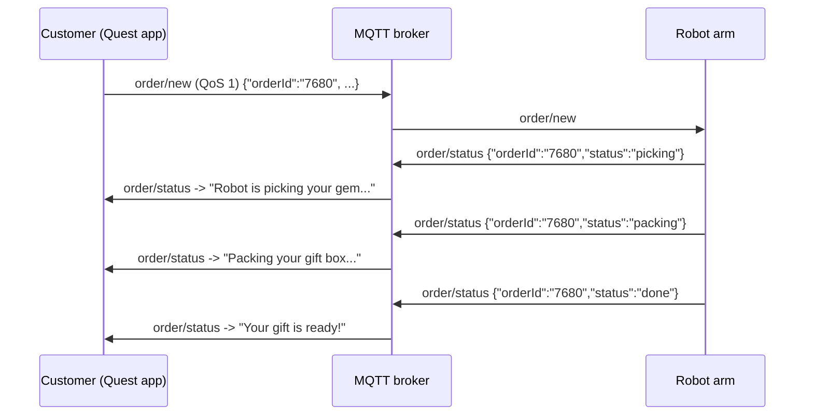

# MQTT Interface — Gem Store AR ↔ Robot Arm

เอกสารสรุปการสื่อสารระหว่างแอป Gem Store AR (Unity, Meta Quest 3) กับระบบแขนกล ผ่าน MQTT
(This document is for the mechanical / robot-arm team. The app is the **publisher of orders** and the **subscriber of order status**.)

- แอปใช้ **MQTTnet 4.3.7** (MQTT 3.1.1 / 5 broker ใด ๆ ใช้ได้ เช่น Mosquitto, EMQX)
- ค่าทั้งหมดตั้งได้ที่ `Assets/_Project/Data/MqttSettings.asset` (broker, port, topic prefix, user/password, TLS)

---

## 1. Broker

| Item | Default | Notes |
|---|---|---|
| Host | `127.0.0.1` | บน Quest ต้องใส่ **IP ของเครื่อง broker ใน LAN เดียวกัน** (ห้ามใช้ `localhost`) |
| Port | `1883` | TCP, ไม่มี TLS (เปิด `Use Tls` ใน settings ถ้าต้องการ) |
| Auth | none | ใส่ `Username` / `Password` ใน settings ได้ |
| Client id | `gemstore-app-xxxxxx` | ต่อท้ายด้วยตัวอักษรสุ่ม 6 ตัว ทุกครั้งที่เชื่อมต่อ |
| Clean session | yes | |
| Keep-alive | 30 s | |
| Last Will | none | |

ถ้าเชื่อมต่อไม่ได้ แอปจะลองใหม่เรื่อย ๆ (หน่วง 2, 4, 8, 16, 30 วินาที แล้วคงที่ 30 วินาที)
ข้อความ order ที่ส่งตอนออฟไลน์จะถูกเก็บไว้ (สูงสุด 50 ข้อความ) และส่งหลังเชื่อมต่อใหม่

> Quest ต้องอยู่ Wi-Fi เดียวกับ broker และ firewall ของเครื่อง broker ต้องเปิดพอร์ต 1883

## 2. Topics

`{prefix}` ค่าเริ่มต้นคือ `gemstore`

| Topic | Direction | QoS | Retain | Payload |
|---|---|---|---|---|
| `{prefix}/order/new` | App → Robot | 1 | no | Order JSON (หัวข้อ 3) |
| `{prefix}/order/status` | Robot → App | 1 | no | Status JSON (หัวข้อ 4) |

- QoS 1 = *at least once*: **อาจได้ข้อความซ้ำ** ฝั่งหุ่นควรใช้ `orderId` เป็นตัวกันซ้ำ
- ไม่ใช้ retain: ตอนแอปเริ่มทำงานจะไม่ได้รับสถานะเก่าที่ค้างอยู่ใน broker
- Payload เป็น UTF-8 JSON บรรทัดเดียว

## 3. Order — `{prefix}/order/new`

แอปส่งทันทีที่ลูกค้าจ่ายเงินสำเร็จ (ก่อนเคลียร์ตะกร้า)

```json
{"orderId":"7680","items":[{"gemId":"gem_diamond_emerald","shape":"Emerald","color":"White","price":120000},{"gemId":"gem_ruby_round","shape":"Round","color":"Red","price":45000}],"total":165000,"time":"2026-11-18T12:53:03"}
```

| Field | Type | Description |
|---|---|---|
| `orderId` | string | เลข 4 หลัก `"1000"`–`"9999"` สุ่มใหม่ทุกออเดอร์ (ไม่รับประกันว่าไม่ซ้ำข้ามวัน) |
| `items` | array | อัญมณีที่ต้องหยิบ 1–9 ชิ้น (ชิ้นเดียวกันซื้อซ้ำในออเดอร์เดียวไม่ได้) |
| `items[].gemId` | string | รหัสอัญมณี (ตารางหัวข้อ 6) |
| `items[].shape` | string | `Round` \| `Emerald` |
| `items[].color` | string | `Red` \| `Blue` \| `Green` \| `Yellow` \| `Purple` \| `Pink` \| `White` |
| `items[].setting` | string | `Loose` \| `Ring` \| `Pendant` (ข้อมูลประกอบ: หุ่นหยิบอัญมณีจาก shape + color เหมือนเดิม) |
| `items[].metal` | string | `Silver` \| `Gold` \| `RoseGold` หรือ `None` ถ้า `setting` เป็น `Loose` (ข้อมูลประกอบ) |
| `items[].price` | int | ราคาเป็นบาท (อัญมณี + ตัวเรือน) |
| `total` | int | ยอดรวมเป็นบาท |
| `time` | string | เวลาจ่ายเงิน รูปแบบ `yyyy-MM-ddTHH:mm:ss` เป็น **เวลาท้องถิ่นของ Quest** (ไม่มี timezone) |

## 4. Order status — `{prefix}/order/status`

หุ่นส่งความคืบหน้าของออเดอร์กลับมา

```json
{"orderId":"7680","status":"picking","message":""}
```

| Field | Type | Description |
|---|---|---|
| `orderId` | string | ต้องตรงกับ `orderId` ของออเดอร์ที่รับมา |
| `status` | string | `picking` \| `packing` \| `done` \| `error` (ตัวพิมพ์เล็ก) |
| `message` | string | รายละเอียดสำหรับทีมงาน (แอปบันทึกลง log ไม่แสดงให้ลูกค้า) ใส่ `""` ได้ |

ข้อความที่แสดงบนจอเครื่องรูดบัตร / ใบเสร็จ:

| `status` | Text shown to the customer |
|---|---|
| `picking` | Robot is picking your gem... |
| `packing` | Packing your gift box... |
| `done` | Your gift is ready! (มี 🎁 ต่อท้ายเมื่อฟอนต์รองรับ emoji) |
| `error` | Please call staff |

ลำดับปกติ: `picking` → `packing` → `done` (หรือ `error` ได้ทุกขั้นตอน)
ส่งซ้ำสถานะเดิมได้ ไม่มีผลเสีย

กฎของแอป:
- ข้อความที่ `orderId` ไม่ตรงกับออเดอร์ล่าสุดที่เครื่องรูดบัตรแสดงอยู่ จะถูกละเว้น
- ข้อความที่ JSON ผิดรูปแบบ หรือ `status` ไม่รู้จัก จะถูกละเว้นและบันทึก warning
- **ถ้าไม่มีสถานะตอบกลับภายใน 10 วินาที** หลังจ่ายเงิน จอจะแสดงเพียง `Order sent` แล้วหายไปเอง (ไม่ค้างรอ)
  ถ้าสถานะมาช้ากว่านั้น จะไม่ถูกแสดงแล้ว
- สถานะสุดท้าย (`done` / `error` / `Order sent`) ค้างบนจอ 8 วินาทีแล้วหายไป

## 5. Sequence



## 6. Gem catalogue

ตู้โชว์ 3×3 (แถว 0 อยู่บนสุด, ซ้าย→ขวา ตามที่ลูกค้ามองเห็น) — `slot = row * 3 + column`

| Slot | Row, Col | gemId | Name | shape | color | price (THB) |
|---|---|---|---|---|---|---|
| 0 | 0, 0 | `gem_ruby_round` | Ruby Round | Round | Red | 45,000 |
| 1 | 0, 1 | `gem_sapphire_round` | Sapphire Round | Round | Blue | 38,000 |
| 2 | 0, 2 | `gem_amethyst_round` | Amethyst Round | Round | Purple | 4,800 |
| 3 | 1, 0 | `gem_tsavorite_emerald` | Tsavorite Emerald | Emerald | Green | 68,000 |
| 4 | 1, 1 | `gem_diamond_emerald` | Diamond Emerald | Emerald | White | 120,000 |
| 5 | 1, 2 | `gem_morganite_emerald` | Morganite Emerald | Emerald | Pink | 28,000 |
| 6 | 2, 0 | `gem_peridot_round` | Peridot Round | Round | Green | 9,500 |
| 7 | 2, 1 | `gem_sapphire_emerald` | Sapphire Emerald | Emerald | Blue | 52,000 |
| 8 | 2, 2 | `gem_citrine_round` | Citrine Round | Round | Yellow | 6,200 |

(ตำแหน่ง slot ในตู้เสมือน ใช้เป็นข้อมูลอ้างอิงเท่านั้น — ตำแหน่งจริงในคลังของหุ่นให้ทีมกลไกกำหนดเอง โดยแมปจาก `gemId`)

## 7. ทดลองส่ง/รับด้วยมือ

**Mosquitto (command line)**

```powershell
# ดูทุกข้อความของระบบ
mosquitto_sub -h <broker-ip> -t "gemstore/#" -v

# จำลองหุ่นตอบสถานะ (เปลี่ยน orderId ให้ตรงกับออเดอร์จริง)
mosquitto_pub -h <broker-ip> -q 1 -t "gemstore/order/status" -m "{\"orderId\":\"7680\",\"status\":\"picking\",\"message\":\"\"}"
mosquitto_pub -h <broker-ip> -q 1 -t "gemstore/order/status" -m "{\"orderId\":\"7680\",\"status\":\"packing\",\"message\":\"\"}"
mosquitto_pub -h <broker-ip> -q 1 -t "gemstore/order/status" -m "{\"orderId\":\"7680\",\"status\":\"done\",\"message\":\"\"}"
```

**MQTTX**
1. New Connection: Host = IP ของ broker, Port = 1883, MQTT 3.1.1 หรือ 5.0
2. Subscribe `gemstore/#` (QoS 1) แล้วซื้อของในแอป จะเห็นข้อความที่ `gemstore/order/new`
3. Publish ไปที่ `gemstore/order/status` (QoS 1, Retain ปิด) ด้วย JSON ในหัวข้อ 4

**ทดสอบใน Unity โดยไม่ต้องมีหุ่น** (เฉพาะ Editor ใน Play Mode): หลังจ่ายเงินแล้ว ใช้เมนู
`GemStore → Simulate Robot Status` หรือปุ่มใน Inspector ของ `Network → OrderStatusListener`
ถ้าเชื่อมต่อ broker อยู่ ข้อความจะวิ่งผ่าน broker จริง (เห็นใน MQTTX ได้) ถ้าไม่ได้เชื่อมต่อ จะฉีดเข้าแอปตรง ๆ

## 8. Troubleshooting

| อาการ | สาเหตุที่พบบ่อย |
|---|---|
| Console ขึ้น `[MQTT] Cannot connect to ...` | broker ไม่ได้รัน / IP หรือ port ผิด / firewall / Quest คนละ Wi-Fi |
| จ่ายเงินแล้วไม่เห็นข้อความใน MQTTX | subscribe topic ไม่ตรง prefix, หรือแอปยังเชื่อมต่อ broker ไม่สำเร็จ (ข้อความรออยู่ในคิว) |
| ส่ง status แล้วจอไม่เปลี่ยน | `orderId` ไม่ตรงกับออเดอร์ล่าสุด, ส่งช้ากว่า 10 วินาที, หรือ JSON/`status` ผิด (ดู warning ใน Console) |
| บน Quest เชื่อมต่อไม่ได้แต่ใน Editor ได้ | ใช้ `127.0.0.1` ใน settings — ให้ใช้ IP ของเครื่อง broker |

## 9. ค่าที่ทีมแอปตั้งไว้เอง (ขอให้ทีมหุ่นยืนยัน)

ชื่อ topic, รูปแบบ JSON, QoS 1 และกฎ timeout 10 วินาที เป็นข้อเสนอจากทีมแอป ถ้าทีมกลไก/แขนกลต้องการเปลี่ยน
แก้ได้ที่ `MqttSettings.asset` (prefix) และคลาส `Order` / `OrderStatusMessage` ในโปรเจกต์
