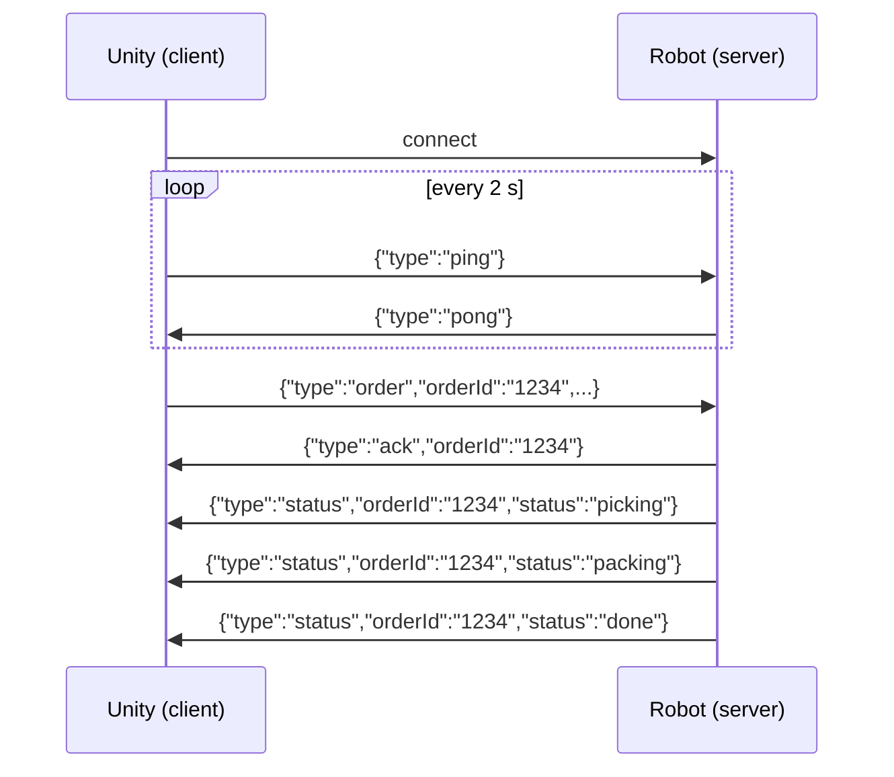

# Robot TCP Interface — Gem Store AR ↔ Robot Arm

For the robot / mechanical team. The Unity app (Meta Quest 3) is the **TCP client**; the robot controller is the **TCP server**.
(MQTT is a separate, optional path: see `MQTT_Interface.md`. If both are used, de-duplicate orders by `orderId`.)

## 1. Connection

| Item | Value |
|---|---|
| Role of robot | TCP **server** (listen) |
| Port | `5005` (default) |
| Host | The Quest needs the **LAN IP** of the robot PC (not `127.0.0.1`). Set it in `Assets/_Project/Data/RobotLinkConfig.asset`. Open port 5005 in the firewall. |
| Framing | One JSON object per line, UTF-8, each line ends with `\n`. No newline inside a message. |
| Heartbeat | Unity sends `{"type":"ping"}` every **2 s**. Reply `{"type":"pong"}`. |
| Link lost | If Unity receives **nothing at all** for **6 s**, it drops the link and reconnects every **3 s**. Any message counts as a sign of life. |
| Robot → Unity ping | Allowed: Unity answers `{"type":"pong"}`. |

Every message has a `"type"` field. Unknown types are ignored (Unity logs a warning), so you can add your own.

## 2. Messages

### ping / pong (both directions)
```json
{"type":"ping"}
{"type":"pong"}
```

### order — Unity → robot
Sent after the customer paid.
```json
{"type":"order","orderId":"1234","items":[{"gemId":"gem_ruby_round","shape":"round","color":"red","setting":"ring","metal":"gold"}]}
```
| Field | Description |
|---|---|
| `orderId` | 4-digit string `"1000"`–`"9999"` |
| `items` | 1–9 gems to pick |
| `items[].gemId` | see the catalogue below |
| `items[].shape` | lowercase: `round` \| `emerald` |
| `items[].color` | lowercase: `red` \| `blue` \| `green` \| `yellow` \| `purple` \| `pink` \| `white` |
| `items[].setting` | lowercase, **informational**: `loose` \| `ring` \| `pendant` (how the customer wants the gem finished) |
| `items[].metal` | lowercase, **informational**: `silver` \| `gold` \| `rosegold`; `none` when `setting` is `loose` |

The robot still picks the gem by `shape` + `color` (and `gemId`). `setting` and `metal` are for the packing / jeweller step; ignore them if you do not need them. Older apps may omit both fields, so treat them as optional (`loose` / `none` by default). A loose gem order looks like `...,"color":"red","setting":"loose","metal":"none"}`.

**Reliability:** an order is queued in the app until the robot is connected, and is **resent every 5 s (max 3 tries per connection) until you send an `ack`**. The same order may therefore arrive more than once: **de-duplicate by `orderId`**, but ack every copy.

### ack — robot → Unity
Send immediately after an order is received (before you start moving).
```json
{"type":"ack","orderId":"1234"}
```

### status — robot → Unity
```json
{"type":"status","orderId":"1234","status":"picking","message":""}
```
`status` is `picking` \| `packing` \| `done` \| `error`. `message` is free text for staff (logged, not shown to the customer).

Shown on the customer's receipt screen:

| status | Text |
|---|---|
| `picking` | Robot is picking your gem... |
| `packing` | Packing your gift box... |
| `done` | Your gift is ready! |
| `error` | Something went wrong – please call staff |

If no status arrives within **10 s** after payment the screen shows "Order sent" and moves on (it never hangs); later statuses are ignored.

## 2b. Teleoperation (hand-follow)

**All teleop coordinates are in the ROBOT frame, in millimetres** (`r` = wrist rotation in degrees, currently always 0).
Unity converts its own world (metres) to this frame with the 3-point calibration (`TeleopConfig` reference points). Unity clamps every
target to the configured workspace box, but **the robot must enforce its own limits too**.

### teleop — Unity → robot
Sent at `sendRateHz` (default 10 Hz) while the operator holds the deadman (right grip / pinch) **and** the target moved at least
`minMoveMm` (default 5 mm) since the last one sent. The target is already smoothed (One Euro filter).
```json
{"type":"teleop","seq":123,"enable":true,"x":250.0,"y":-30.5,"z":40.0,"r":0.0,"grip":false}
```
| Field | Meaning |
|---|---|
| `seq` | Increasing counter; the robot should ignore a message with a `seq` not newer than the last one |
| `enable` | `true` = follow this target |
| `x`,`y`,`z` | Absolute target position, mm |
| `r` | Rotation, degrees |
| `grip` | `true` = gripper closed / suction on, `false` = open / off |

When the operator releases the deadman, hand tracking is lost, the link drops or the app loses focus, Unity sends once:
```json
{"type":"teleop","enable":false}
```
→ the robot must **stop and hold its current position** (no target). Unity sends nothing before the calibration is done.

### estop — Unity → robot
```json
{"type":"estop"}
```
Emergency stop: stop all motion immediately and ignore `teleop` until `estop_reset`. Unity may repeat it (also after a reconnect).

### estop_reset — Unity → robot
```json
{"type":"estop_reset"}
```
Sent when the operator presses **Reset**. The robot accepts `teleop` again (Unity additionally requires a fresh grip press).

### robot_pose — robot → Unity
Where the robot really is; stream it at about **10 Hz** (units mm, degrees). Unity shows a blue marker there (hidden if no pose for 2 s).
An optional `"grip": true|false` (gripper / suction state) is allowed and ignored by Unity for now.
```json
{"type":"robot_pose","x":248.3,"y":-12.0,"z":40.2,"r":0.0}
```

### Control modes, speed and precision (Unity side, no new messages)
The robot always receives the same `teleop` messages; the mode only changes how Unity computes the target.

| Mode | Target | Speed limit applied by Unity |
|---|---|---|
| OFFSET (default, safe) | the hand's position inside a floating "control volume" (1:1 copy of the workspace box, in front of the technician) maps to the same position in the workspace | `maxSpeedMmPerSec` (100) |
| ABSOLUTE | the hand's real position, through the calibration | `absoluteMaxSpeedMmPerSec` (30) |

Unity moves the commanded target toward the hand at most at that speed, starting from the robot's last `robot_pose`, so the robot never
receives a sudden far-away target. **Precision mode** (left grip / A held) scales hand motion by `precisionScale` (0.3) around the point
where it started; the messages are the same. The robot must still enforce its own speed and workspace limits.

### Pick / Place macros (Unity → robot, ordinary `teleop` messages)
The app runs these as short sequences of `teleop` messages; **no new message types**. They start from the Pick / Place buttons (or the
X / Y controller buttons, keyboard P / L) while the deadman is held, need a fresh `robot_pose`, and keep the robot's current x/y.
Heights come from `TeleopConfig`: `pickZ` (default 5 mm = zMin + 5), `placeZ` (5 mm), `safeZ` (80 mm), `gripWaitSeconds` (0.5 s).
Each step is sent at the normal rate (10 Hz) and the next step starts when `robot_pose` is within 3 mm of the step's target (or after a
6 s timeout, or at once when no pose is reported).

**Pick** (x, y = current):

| # | target | grip | then |
|---|---|---|---|
| 1 | (x, y, pickZ) | false | wait until reached |
| 2 | (x, y, pickZ) | **true** (suction on) | wait `gripWaitSeconds` (0.5 s) |
| 3 | (x, y, safeZ) | true | wait until reached |

**Place** (x, y = current):

| # | target | grip | then |
|---|---|---|---|
| 1 | (x, y, placeZ) | true | wait until reached |
| 2 | (x, y, placeZ) | **false** (release) | wait `gripWaitSeconds` |
| 3 | (x, y, safeZ) | false | wait until reached |

Example Pick at x=250, y=0 (seq numbers increase as usual):
```json
{"type":"teleop","seq":41,"enable":true,"x":250.0,"y":0.0,"z":5.0,"r":0.0,"grip":false}
{"type":"teleop","seq":50,"enable":true,"x":250.0,"y":0.0,"z":5.0,"r":0.0,"grip":true}
{"type":"teleop","seq":56,"enable":true,"x":250.0,"y":0.0,"z":80.0,"r":0.0,"grip":true}
{"type":"teleop","enable":false}
```
When the sequence ends Unity sends `{"type":"teleop","enable":false}` once (the robot holds at safeZ).

**Abort:** releasing the deadman sends `{"type":"teleop","enable":false}` and the sequence stops at once; **E-STOP** sends
`{"type":"estop"}`. The robot must stop on both and must not continue a half-done sequence by itself.

## 3. Sequence



## 4. Gem catalogue

| gemId | shape | color |
|---|---|---|
| `gem_ruby_round` | round | red |
| `gem_sapphire_round` | round | blue |
| `gem_amethyst_round` | round | purple |
| `gem_tsavorite_emerald` | emerald | green |
| `gem_diamond_emerald` | emerald | white |
| `gem_morganite_emerald` | emerald | pink |
| `gem_peridot_round` | round | green |
| `gem_sapphire_emerald` | emerald | blue |
| `gem_citrine_round` | round | yellow |

## 5. Minimal Python server

```python
import json, socket, threading, time

def serve(conn):
    buf = b""
    while True:
        data = conn.recv(4096)
        if not data:
            break
        buf += data
        while b"\n" in buf:
            line, buf = buf.split(b"\n", 1)
            msg = json.loads(line)
            send = lambda o: conn.sendall((json.dumps(o) + "\n").encode())
            if msg["type"] == "ping":
                send({"type": "pong"})
            elif msg["type"] == "order":
                send({"type": "ack", "orderId": msg["orderId"]})
                def work(oid=msg["orderId"]):
                    for s in ("picking", "packing", "done"):
                        time.sleep(2)
                        send({"type": "status", "orderId": oid, "status": s, "message": ""})
                threading.Thread(target=work, daemon=True).start()

server = socket.socket(); server.setsockopt(socket.SOL_SOCKET, socket.SO_REUSEADDR, 1)
server.bind(("0.0.0.0", 5005)); server.listen(5)
while True:
    c, _ = server.accept()
    threading.Thread(target=serve, args=(c,), daemon=True).start()
```

A fuller version that also de-duplicates orders and prints teleop messages is in `Tools/mock_robot_server.py`
(`python Tools/mock_robot_server.py`, option `--no-ack` to test the app's resend logic).
