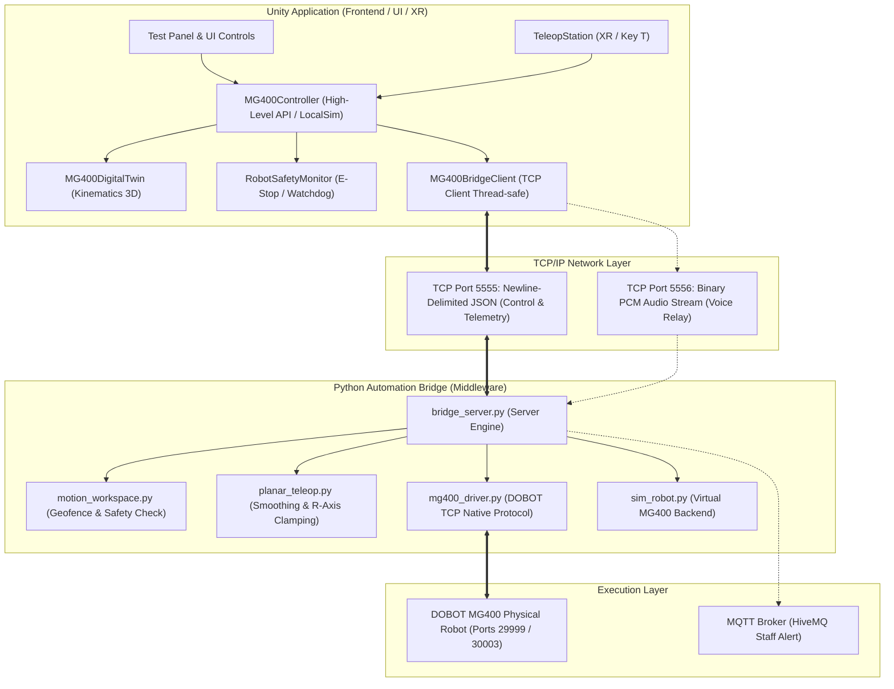

# คู่มือเชิงลึก: สถาปัตยกรรม โครงสร้างไฟล์ และการประยุกต์ใช้งานชุดควบคุม DOBOT MG400 ใน Unity

เอกสารฉบับนี้จัดทำขึ้นเพื่ออธิบายรายละเอียดทางเทคนิค สถาปัตยกรรมการทำงาน โครงสร้างไฟล์ทั้งหมด และขั้นตอนการนำโฟลเดอร์ `MG400_Unity_Control` ไปใช้งานร่วมกับโปรเจกต์ Unity อื่นอย่างเป็นระบบ

---

## 1. วัตถุประสงค์และภาพรวมของระบบ (System Overview)

โฟลเดอร์นี้คือ **ชุดบูรณาการระบบควบคุมแขนกลหุ่นยนต์อุตสาหกรรมขนาดเล็ก DOBOT MG400 ร่วมกับเอนจิน Unity** (เดิมพัฒนาในโปรเจกต์ CPE494 สำหรับระบบจัดเก็บอัญมณีและซ่อมบำรุงทางไกลผ่าน AR/VR) 

ระบบนี้ถูกออกแบบมาเพื่อทำหน้าที่สำคัญ 4 ประการ:
1. **Digital Twin (ฝาแฝดดิจิทัล):** แสดงผลการเคลื่อนไหวของหุ่นยนต์ MG400 ใน Unity แบบ 3D แบบเรียลไทม์ โดยหมุนข้อต่อ J1–J4 และขยับปลายแขน (TCP) ตามค่าเซนเซอร์จริงจากตัวหุ่นยนต์
2. **Teleoperation (การควบคุมระยะไกลตามมือ/คอนโทรลเลอร์):** ผู้ใช้งานสามารถใช้ XR Controller หรือปุ่มคีย์บอร์ด เพื่อสั่งให้ปลายแขนของหุ่นยนต์ขยับตามพิกัดมือบนระนาบ 2D แบบเรียลไทม์
3. **Safety Interlocking & Workspace Geofencing:** มีเลเยอร์ความปลอดภัยขั้นสูงทั้งใน Unity และ Python คอยตรวจสอบขอบเขตพื้นที่ทำงาน (Safety Polygon Bounds) และรัศมีการเอื้อม เพื่อป้องกันไม่ให้หุ่นยนต์ชนสิ่งกีดขวางหรือสั่งงานเกินระยะขีดจำกัด
4. **Seamless Hybrid Simulation:** รองรับทั้งการเชื่อมต่อกับ **หุ่นยนต์จริง**, **Python Sim Robot** (จำลองฝั่งเซิร์ฟเวอร์), และ **LocalSim** (จำลองภายใน Unity เองเมื่อไม่ได้เปิด Python Bridge)

---

## 2. สถาปัตยกรรมการทำงาน (System Architecture)

ระบบใช้สถาปัตยกรรมแบบแยกชั้น (Decoupled Architecture) สื่อสารกันผ่านเครือข่าย TCP ทำให้โปรเจกต์ Unity และเซิร์ฟเวอร์ควบคุมสามารถรันอยู่บนเครื่องเดียวกัน หรือแยกเครื่องผ่านระบบ LAN ได้



### การไหลของข้อมูล (Data Flow)
1. **ฝั่งส่งคำสั่ง (Command Pipeline):**
   * เมื่อผู้ใช้สั่งงาน (เช่น กดปุ่มบน Panel, ขยับมือในโหมด Teleop หรือเรียกผ่าน C# API) `MG400Controller` จะจัดเตรียมคำสั่ง
   * `MG400BridgeClient` ส่งคำสั่งรูปแบบ JSON ผ่าน TCP Port 5555 ไปยัง `bridge_server.py`
   * `motion_workspace.py` และ `planar_teleop.py` ตรวจสอบว่าพิกัดเป้าหมายและเส้นทางการเคลื่อนที่อยู่ในกรอบความปลอดภัยหรือไม่ หากพิกัดหลุดขอบ ระบบจะทำ Clamping หรือตัดทอนระยะให้อยู่ในขอบเขตที่ปลอดภัย
   * `mg400_driver.py` แปลงคำสั่งเป็น Dobot Native Protocol (เช่น `MovL`, `MovJ`, `DO`) แล้วส่งผ่าน TCP พอร์ต 29999/30003 ไปยังแขนกลจริง
2. **ฝั่งรับข้อมูลสถานะ (Telemetry Pipeline):**
   * บริดจ์ดึงข้อมูลมุมข้อต่อ (Joint angles) และพิกัดปลายแขน (Cartesian pose: X, Y, Z, R) จากแขนกลจริงหรือ Sim ทุกๆ รอบลูป
   * บริดจ์กระจาย JSON State (`{"type":"state", "joints":[...], "pose":[...]}`) กลับมาที่ Unity ผ่าน Port 5555
   * `MG400BridgeClient` รับข้อมูลแบบ Asynchronous ข้ามเธรดลงสู่ `ConcurrentQueue` และส่งต่อเข้า Unity Main Thread
   * `MG400DigitalTwin` รับค่าองศาข้อต่อแล้วหมุนกระดูก 3D ของแขนกลในฉากให้ตรงกับหุ่นยนต์จริง

---

## 3. โครงสร้างไฟล์และหน้าที่อย่างละเอียด (Detailed File Structure)

```
MG400_Unity_Control/
│
├── README_TH.md                         # คู่มือสรุปการติดตั้งและใช้งานเบื้องต้น
├── PROJECT_OVERVIEW_TH.md               # เอกสารรายละเอียดเชิงลึกฉบับนี้
│
├── Docs/
│   └── MG400_Workspace_XY.png           # ภาพผังพิกัดและเส้นทางความปลอดภัยของระนาบ XY
│
├── Python_Automation/                   # โค้ดส่วน Python Bridge Server และ Driver
│   ├── bridge_server.py                 # ศูนย์กลางเซิร์ฟเวอร์ TCP จัดการคำสั่งและสถานะ
│   ├── mg400_driver.py                  # ไดรเวอร์เชื่อมต่อ Dobot Native Socket Protocol
│   ├── motion_workspace.py              # ระบบตรวจสอบความปลอดภัยขอบเขตพิกัดและการตัดระยะ
│   ├── planar_teleop.py                 # ระบบคำนวณการเคลื่อนที่ตามคอนโทรลเลอร์บนระนาบ
│   ├── sim_robot.py                     # คลาสจำลองพฤติกรรมแขนกลเสมือน (Software Sim)
│   ├── requirements.txt                 # รายการไลบรารี Python เสริม (MQTT, Audio)
│   ├── Start-MG400Bridge.ps1            # สคริปต์ PowerShell สำหรับเริ่มและจัดการโปรเซส Bridge
│   └── Start-MG400Bridge.cmd            # สคริปต์ Batch wrapper เพื่อดับเบิลคลิกรันบน Windows
│
└── Unity_Assets/
    └── MG400Control/                    # โฟลเดอร์สำหรับคัดลอกลงในโฟลเดอร์ Assets ของ Unity
        ├── Runtime/                     # สคริปต์หลักสำหรับรันระบบควบคุม
        │   ├── MG400BridgeClient.cs     # ตัวจัดการ TCP Client, เธรดเครือข่าย และ JSON Parser
        │   ├── MG400Controller.cs       # คอนโทรลเลอร์ระดับสูง, Coroutines การเคลื่อนที่ และ LocalSim
        │   ├── MG400DigitalTwin.cs      # ควบคุมกระดูก 3D และจำลองการหมุนตาม Forward Kinematics
        │   ├── MG400Geometry.cs         # ค่าพารามิเตอร์เชิงกลและฟังก์ชันคำนวณ Kinematics
        │   ├── RobotSafetyMonitor.cs    # ตรวจสอบ E-Stop, Safe Zone และ Heartbeat Watchdog
        │   └── TeleopStation.cs         # จัดการโหมดติดตามมือ (Hand Tracking) / XR Controller
        │
        └── Compatibility/               # สคริปต์จำลองการทำงานของบริบทเดิม (Gem Pickup)
            ├── FallenGemSpawner.cs      # จำลองการสุ่มเกิดชิ้นงานที่ต้องหยิบในฉาก
            ├── GemInfo.cs               # ข้อมูลคุณลักษณะของชิ้นงาน
            └── GemStorage.cs            # จุดจัดเก็บชิ้นงานหลังหยิบเสร็จ
```

### หน้าที่ของแต่ละไฟล์ในเชิงลึก

#### 1. ส่วน Python Automation (`Python_Automation/`)
* **`bridge_server.py`:**
  * หัวใจหลักของเซิร์ฟเวอร์ เชื่อมโยงทุกระบบเข้าด้วยกัน
  * สร้าง TCP Server พอร์ต 5555 สำหรับคำสั่ง JSON
  * รองรับ Command สำคัญ: `enable`, `disable`, `home`, `speed`, `move_joints`, `move_to`, `check_packing_workspace`, `do` (เปิด/ปิดหัวดูด), `teleop_xy_*`, `raw`
  * มีออปชัน Voice Relay (TCP พอร์ต 5556) และแจ้งเตือนผ่าน MQTT Broker
* **`motion_workspace.py`:**
  * กำหนดกรอบพื้นที่ทำงานเชิงกายภาพ (Convex Polygon) จากพิกัดมุม 4 จุด: `CORNERS = ((191.35, 1.91), (341.67, 13.57), (315.45, 296.70), (130.25, 348.13))`
  * กำหนดขอบเขตรัศมีการเอื้อมของแขนกล: Min Radius = 220 มม., Max Radius = 440 มม.
  * ฟังก์ชัน `contains_xy(point)`: ตรวจสอบว่าพิกัดอยู่ในพื้นที่ปลอดภัยหรือไม่
  * ฟังก์ชัน `limit_segment(start, end)`: ทำหน้าที่ตัดทอนเวกเตอร์การเคลื่อนที่ หากผู้ใช้สั่งให้แขนกลพุ่งออกนอกกรอบ ระบบจะหยุดแขนกลไว้ตรงขอบเขตทันที (Prevent boundary violation)
  * ฟังก์ชัน `entry_route(start)`: คำนวณเส้นทางเดินกลับเข้าสู่พื้นที่ทำงานหากแขนกลอยู่นอกกรอบ
* **`planar_teleop.py`:**
  * จัดการการติดตามตำแหน่งมือ/คอนโทรลเลอร์แบบระนาบ 2D (XY)
  * กำหนดขอบเขตมุมแกน R (หมุนปลายแขน) ให้อยู่ระหว่าง −90° ถึง −55°
  * มีระบบ Deadband (ระยะฟรี 0.2 มม.) และกรองความเร็ว (Speed Factor 20) เพื่อให้การขยับมีความนุ่มนวลและปลอดภัย
  * ล็อกแกน Z ให้อยู่ระดับความสูงคงที่ขณะทำ Teleop
* **`sim_robot.py`:**
  * ตัวจำลองคิเนมาติกส์และฟังก์ชันของ Dobot MG400 ทำงานบนหน่วยความจำ
  * ตอบกลับสถานะและตำแหน่งพิกัดเสมือน ทำให้ทดสอบระบบได้โดยไม่ต้องมีหุ่นยนต์จริง
* **`mg400_driver.py`:**
  * จัดการเชื่อมต่อ TCP ตรงไปยัง Dobot MG400
  * รองรับโปรไฟล์ MG400 (Dashboard 29900/29901 พร้อม CRC16) และโปรไฟล์ซีรีส์ CR (Dashboard 29999 / Motion 30003)
* **`Start-MG400Bridge.ps1` & `.cmd`:**
  * ตัวเปิดระบบอัตโนมัติ ค้นหา `python.exe` หรือ `py.exe`
  * ตรวจสอบว่าพอร์ต 5555/5556 ถูกเปิดค้างอยู่หรือไม่ หากมีโปรเซสเดิมเปิดอยู่จะทำการปิดให้ก่อนเริ่มใหม่
  * ป้องกันการชนกันของคำสั่งเมื่อ Unity ยังต่อค้างอยู่

#### 2. ส่วน Unity Runtime (`Unity_Assets/MG400Control/Runtime/`)
* **`MG400BridgeClient.cs`:**
  * รับผิดชอบการเชื่อมต่อ Network ฝั่ง Unity
  * รัน Reader Thread ในพื้นหลังเพื่อรับ JSON Stream จาก Bridge
  * มีระบบ Auto-Reconnect ทุก 3 วินาที และส่ง Ping ทุก 5 วินาที
  * ใช้ Event Pattern: `OnState`, `OnAck`, `OnEvent`, `OnConnectionChanged`
* **`MG400Controller.cs`:**
  * คลาสควบคุมหลักที่เป็น Singleton (`MG400Controller.Instance`)
  * จัดเตรียมฟังก์ชันสำหรับสั่งงานแขนกล เช่น `MoveCartesianMm(x, y, z, r)`, `Home()`, `SetSpeed(pct)`, `SetDigitalOutput(index, state)`
  * **LocalSim Mode:** หากไม่ได้เปิด Python Bridge ตัวคอนโทรลเลอร์จะสลับไปใช้คิเนมาติกส์จำลองภายในเครื่องโดยอัตโนมัติ ทำให้การนำเสนอหรือทดสอบซีนใน Unity ทำงานต่อได้โดยไม่ติดขัด
  * วาดหน้าต่าง **Test Panel (GUI)** บนหน้าจอ Game View ใน Unity Editor ให้สามารถกด Jog แกน X, Y, Z ได้ทันที
* **`MG400DigitalTwin.cs`:**
  * ทำหน้าที่เป็น Visual Digital Twin
  * ควบคุม GameObject ของข้อต่อ: `j1Base`, `j2RearArm`, `j3Forearm`, `j4Tool`
  * คำนวณมุมหมุนสัมพันธ์และ Smoothing การเคลื่อนไหวด้วย `followSpeed`
* **`MG400Geometry.cs`:**
  * บรรจุค่าคงที่ทางกลของแขนกล MG400:
    * ความยาวฐานถึงข้อต่อ 2 ($L_1 = 175$ มม.)
    * ความยาวท่อนแขนบน ($L_2 = 175$ มม.)
    * ความยาวท่อนแขนล่าง ($L_3 = 175$ มม.)
    * ความยาวปลายเครื่องมือ ($L_4 = 66$ มม.)
  * ฟังก์ชัน Forward Kinematics (คำนวณหา X, Y, Z จากองศาข้อต่อ)
* **`RobotSafetyMonitor.cs`:**
  * จัดการคำสั่งหยุดฉุกเฉิน E-Stop (ปุ่มลัด **F9** เพื่อ E-Stop, **F10** เพื่อปลดล็อก)
  * รองรับการกำหนด Trigger Collider เป็น Safety Zone หากมีบุคคลหรือวัตถุแปลกปลอมเข้ามา ระบบ Teleop จะหยุดชะงักทันที
* **`TeleopStation.cs`:**
  * แปลงการเลื่อนของมือ/XR Controller ให้กลายเป็นเวกเตอร์ $dX, dY$ บนระนาบการทำงาน
  * สลับเข้าสู่โหมด Teleop ได้ด้วยการกดปุ่ม **T** บนคีย์บอร์ด

---

## 4. โปรโตคอลการสื่อสาร (JSON Wire Protocol: Port 5555)

การแลกเปลี่ยนข้อมูลระหว่าง Unity และ Python Bridge เป็นแบบข้อความ JSON บรรทัดเดียวต่อหนึ่งคำสั่ง (Newline-delimited JSON)

### ตัวอย่างคำสั่งจาก Unity สู่ Python Bridge:
| คำสั่ง | รูปแบบ JSON Payload | คำอธิบาย |
| :--- | :--- | :--- |
| เปิดการทำงานมอเตอร์ | `{"id": 1, "cmd": "enable"}` | Enable มอเตอร์ทุกแกน |
| สั่ง Home | `{"id": 2, "cmd": "home"}` | ส่งแขนกลกลับจุด Home |
| ปรับความเร็ว | `{"id": 3, "cmd": "speed", "pct": 50}` | กำหนดความเร็ว 1–100% |
| เคลื่อนที่พิกัดคาร์ทีเซียน | `{"id": 4, "cmd": "move_to", "x": 250.0, "y": 10.0, "z": 50.0, "r": -60.0, "type": "L"}` | เดินเชิงเส้น (L) หรือตามข้อต่อ (J) |
| สั่งหัวดูดสุญญากาศ (DO) | `{"id": 5, "cmd": "do", "index": 1, "value": true}` | เปิด/ปิด Digital Output ช่อง 1 |
| เริ่มโหมด Teleop | `{"cmd": "teleop_xy_begin"}` | เตรียมความพร้อมก่อนขยับตามมือ |
| เลื่อนตำแหน่ง Teleop | `{"cmd": "teleop_xy_step", "x": 1.5, "y": -0.8}` | ส่งระยะส่วนต่าง $dX, dY$ (มม.) |
| สิ้นสุดโหมด Teleop | `{"cmd": "teleop_xy_end"}` | ออกจากโหมดติดตามมือ |

### ตัวอย่างข้อมูลสถานะจาก Python Bridge สู่ Unity:
```json
{
  "type": "state",
  "t": 1700650000.123,
  "joints": [12.5, 45.2, -10.1, -65.0],
  "pose": [250.4, 15.2, 50.0, -65.0],
  "do1": 1,
  "enabled": 1,
  "sim": false,
  "moving": false
}
```

---

## 5. สรุปภาพรวมและขั้นตอนการนำไปประยุกต์ใช้งาน (Integration Guide)

### ขั้นตอนที่ 1: ติดตั้งในโปรเจกต์ Unity
1. คัดลอกโฟลเดอร์ `Unity_Assets/MG400Control` ไปวางไว้ในไดเรกทอรี `Assets/` ของโปรเจกต์ Unity ปลายทาง (รวมไฟล์ `.meta` ทั้งหมด)
2. ตรวจสอบเวอร์ชันแพ็กเกจใน Unity:
   * **Unity Version:** แนะนำเวอร์ชัน 6000.x (Unity 6) หรือเวอร์ชันที่รองรับ C# 9+
   * **Input System:** แนะนำแพ็กเกจ `com.unity.inputsystem` (New Input System)
   * **XR Interaction Toolkit (XRI):** หากต้องการใช้ระบบติดตามคอนโทรลเลอร์ XR
3. ตั้งค่า Project Settings:
   * ไปที่ `Edit > Project Settings > Player > Other Settings`
   * ตรวจสอบว่า **Active Input Handling** ตั้งเป็น `Input System Package (New)` หรือ `Both`

### ขั้นตอนที่ 2: ตั้งค่า Scene ใน Unity
1. สร้าง GameObject เปล่าขึ้นมาในฉาก เช่น ตั้งชื่อว่า `MG400_Root`
2. ใส่คอมโพเนนต์ต่อไปนี้ใน `MG400_Root`:
   * `MG400BridgeClient`: ตั้งค่า `Host = 127.0.0.1` และ `Control Port = 5555`
   * `MG400Controller`
   * `MG400DigitalTwin`
   * `RobotSafetyMonitor`
3. *(ไม่บังคับ)* หากมีโมเดล 3D ของแขนกล ให้ลาก Transform ของข้อต่อใส่ใน `MG400DigitalTwin`:
   * `j1Base`, `j2RearArm`, `j3Forearm`, `j4Tool`, `tcpMarker`
   *(หากไม่มีโมเดล 3D สามารถปล่อยช่องว่างไว้ได้ ระบบจะยังทำงานผ่าน Test Panel ได้ตามปกติ)*
4. หากต้องการใช้ระบบ Teleoperation:
   * เพิ่มคอมโพเนนต์ `TeleopStation`
   * กำหนด `Pad Center` และผูก `Hand Source` เข้ากับ Controller หรือ XR Interactor

### ขั้นตอนที่ 3: เปิด Python Bridge Server
เปิด Windows PowerShell ในโฟลเดอร์ `Python_Automation/`:

* **กรณีทดสอบแบบจำลอง (ไม่มีหุ่นยนต์จริง):**
  ```powershell
  py -3 bridge_server.py --sim --no-audio --no-mqtt
  ```
* **กรณีเชื่อมต่อกับแขนกลหุ่นยนต์ DOBOT MG400 จริง:**
  * ต่อสาย LAN ระหว่างคอมพิวเตอร์กับหุ่นยนต์ และตั้งค่าให้อยู่ในวง Network เดียวกัน (เช่น IP หุ่นยนต์ค่ามาตรฐานคือ `192.168.1.6`)
  * ดับเบิลคลิกไฟล์ `Start-MG400Bridge.cmd` หรือพิมพ์คำสั่ง:
  ```powershell
  .\Start-MG400Bridge.cmd -RobotIp 192.168.1.6
  ```
  * รอจนหน้าต่างคอนโซลขึ้นสถานะ `robot backend: REAL`

### ขั้นตอนที่ 4: การสั่งงานและทดสอบ
1. กด **Play** ใน Unity Editor
2. ที่แท็บ **Game View** จะปรากฏ Panel `MG400 TEST`:
   * สามารถเลือกความละเอียดระยะก้าว (1, 5, 10 มม.) แล้วกดปุ่ม Jog แกน **X / Y / Z**
   * ควบคุมหัวดูดสุญญากาศด้วยปุ่ม **DO1 ON / OFF**
3. **การทดสอบโหมดติดตามมือ (Teleoperation):**
   * คลิกที่หน้าจอ Game แล้วกดปุ่ม **T** บนคีย์บอร์ด
   * สถานะจะขึ้น `PREPARING CONTROLLER POSE` เพื่อนำแขนเข้าสู่จุดเริ่มต้นที่ปลอดภัย
   * เมื่อขึ้น `CONTROLLER ACTIVE` แขนกลจะเคลื่อนที่ตามการขยับมือ/คอนโทรลเลอร์
   * กดปุ่ม **T** อีกครั้งเพื่อปิดโหมด

---

## 6. สิ่งที่ต้องปรับแต่งเมื่อนำไปใช้กับหน้างานจริง (Customization)

1. **การปรับแต่งกรอบพิกัดโต๊ะงาน (Workspace Boundaries):**
   * หากฐานหุ่นยนต์ ตำแหน่งโต๊ะ หรือชิ้นงานเปลี่ยนไป ให้เปิดไฟล์ `Python_Automation/motion_workspace.py`
   * แก้ไขค่าพิกัด `CORNERS` ทั้ง 4 จุด (เรียงตามลำดับเข็มนาฬิกา 1 → 2 → 4 → 3) และค่า `MIN_RADIUS`, `MAX_RADIUS` เพื่อให้สอดคล้องกับพื้นที่ปฏิบัติงานจริง
2. **การเรียกใช้งานจาก C# Script อื่น:**
   สามารถเรียกใช้ API ของหุ่นยนต์จากสคริปต์ภายนอกได้โดยตรง เช่น:
   ```csharp
   // สั่งเคลื่อนที่ไปยังพิกัดเป้าหมาย (มิลลิเมตร, องศา)
   StartCoroutine(MG400Controller.Instance.MoveCartesianMm(250f, 0f, 50f, -60f));

   // สั่งเปิด-ปิดหัวดูดสุญญากาศ
   StartCoroutine(MG400Controller.Instance.SetDigitalOutput(1, true));

   // ตรวจสอบสถานะการเชื่อมต่อ
   bool isConnected = MG400Controller.Instance.BridgeOnline;
   ```
3. **การ Build สำหรับใช้งานจริง:**
   * หน้าต่าง GUI `MG400 TEST` ถูกครอบด้วย `#if UNITY_EDITOR` หากต้องการปุ่มกดในตัวเกมจริง (Standalone Build) ให้สร้าง UI ผ่าน Canvas ของโปรเจกต์คุณ แล้วสั่งงานผ่าน Method ของ `MG400Controller` โดยตรง
